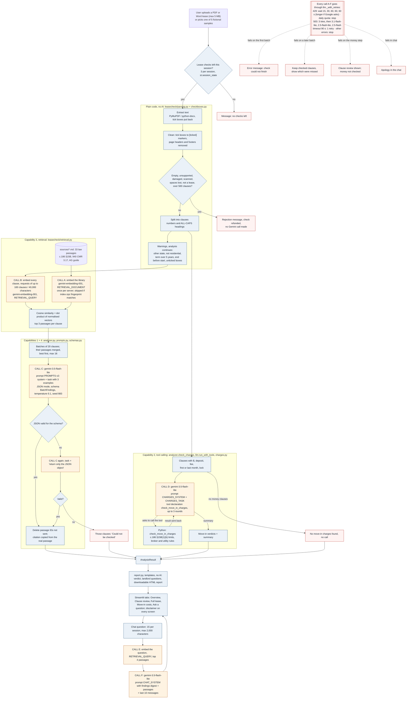

# Architecture (§5.2)

How information moves through the app, from what the user uploads to what they see. It is drawn from the
code on `main`; if you change the code, update this file. Every Gemini call is labelled with the prompt it
sends (the full text of every prompt is in `leasecheck/prompts.py`, and goes in the report's appendix).
Amber boxes call Gemini; blue boxes are plain Python; dashed red arrows are failure paths.

The clause review (call C) and the move-in check (call D) are drawn as two branches because both start from
the same list of clauses; in the code they run one after the other in `analyzer.analyze`, clause review first.

## Every model call and the prompt it sends

| Call | Model | Prompt (in `leasecheck/prompts.py`) | Code | Capability |
| --- | --- | --- | --- | --- |
| A. Embed the law library | `gemini-embedding-001`, task `RETRIEVAL_DOCUMENT` | none: each passage's citation + text | `retrieval.SourceIndex.build` → `llm.embed` | 3 |
| B. Embed the lease's clauses | `gemini-embedding-001`, task `RETRIEVAL_QUERY` | none: each clause's text | `retrieval.SourceIndex.search_many` (from `analyzer.analyze`) | 3 |
| C. Label each batch of clauses | `gemini-3.5-flash-lite` | `PROMPTS["v2"].system` + `PROMPTS["v2"].task` (passages, 3 examples, clauses); retry appends "Your previous answer was not valid JSON…" | `analyzer._classify_with_retry` → `llm.generate_json`, schema `schemas.BatchFindings` | 1, 3, 4 |
| D. Move-in charges | `gemini-3.5-flash-lite` | `CHARGES_SYSTEM` + `CHARGES_TASK`, with the tool declaration `charges.CHECK_MOVE_IN_CHARGES_DECLARATION` | `analyzer.check_charges` → `llm.run_with_tools` → `charges.check_move_in_charges` | 2 |
| E. Embed a chat question | `gemini-embedding-001`, task `RETRIEVAL_QUERY` | none: the question | `app.answer_question` → `search_many` (k = `config.CHAT_TOP_K`) | 3 |
| F. Chat answer | `gemini-3.5-flash-lite` | `CHAT_SYSTEM`, filled with `analyzer.findings_digest` and the retrieved passages; history = last 10 messages | `app.answer_question` → `llm.chat` | 3 |

All chat-model calls use `config.TEMPERATURE` (0.1), `config.SEED` (883), `config.MAX_OUTPUT_TOKENS` (8,192)
and minimal thinking (`llm.GeminiLLM._config`). Backup models apply to calls C, D and F only; embeddings
never switch models, because vectors from different models cannot be compared.

## Failure paths

| What goes wrong | Where it is handled | What the user sees |
| --- | --- | --- |
| No checks left this session | `app.run_check` | "You have used all the lease checks for this session" |
| Empty, unsupported, over 5 MB, damaged or password-protected, scanned, spaces lost, not a lease, over 500 clauses | `parsing.InputRejected`, caught in `app.run_check` | A message saying why; the check is refunded; no Gemini call |
| Another state, commercial or parking lease, term over 5 years, end before start, unticked "check one" boxes | `parsing.load_document` warnings | A warning above the results; the analysis still runs |
| Gemini's answer is not valid JSON | `analyzer._classify_with_retry` | One retry; then those clauses show "Could not be checked" |
| Rate limit, overload, timeout, daily quota, bad key | `llm.GeminiLLM._with_retries` | "Waiting…" / "switching to…" notices; then an error if it still fails |
| Gemini fails after some clauses were checked | `analyzer.analyze` | The checked clauses, plus which ones were missed |
| The money step fails | `analyzer.analyze` | The clause review, with a note that money could not be checked |
| The chat fails | `app.answer_question` | "Sorry, I could not answer that…" in the chat |
